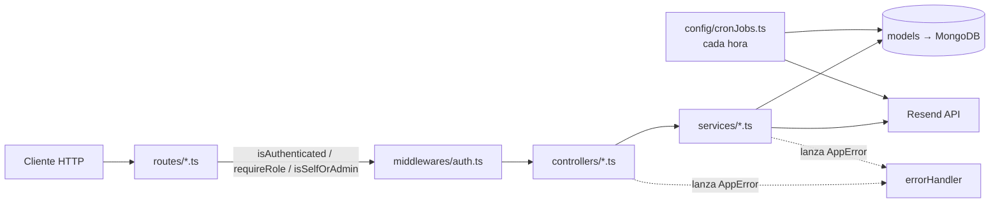

# 01 · Arquitectura

## Estructura del repositorio

```
Magicamente/
├── README.md
├── docs/                        Esta wiki
├── docker-compose.yml           API + MongoDB (`docker compose up --build`)
├── .env.example                 Variables para docker compose
├── .github/workflows/backend.yml  CI: typecheck, build, tests y prueba de la imagen Docker
└── Backend/
    ├── Dockerfile / .dockerignore   Imagen de producción (multi-etapa, usuario no root, healthcheck)
    ├── package.json             Dependencias y scripts
    ├── tsconfig.json            Compilación de src/ → dist/
    ├── tsconfig.test.json       Typecheck de src/ + tests/
    ├── vitest.config.ts
    ├── .env.example
    ├── tests/                   Tests de integración (Vitest + Supertest + MongoDB en memoria)
    └── src/
        ├── index.ts                 Arranque: valida entorno, conecta BD, inicia cron, escucha
        ├── app.ts                   createApp(): Express con rutas y manejo de errores (sin BD)
        ├── config/
        │   ├── env.ts               Lectura y validación de variables de entorno
        │   ├── db.ts                connectDB(uri)
        │   ├── cronJobs.ts          Recordatorios de citas (sendAppointmentReminders, startCronJobs)
        │   ├── migrations.ts        Migración idempotente al arrancar (estados e índices de citas)
        │   └── emailTemplates.ts    Plantillas HTML de correo
        ├── middlewares/
        │   ├── auth.ts              isAuthenticated (JWT + BD), requireRole, isAdmin, isSelfOrAdmin
        │   ├── rateLimiters.ts      Límites de intentos por IP (login, rutas sensibles, general)
        │   ├── asyncHandler.ts      Lleva los errores de handlers async al middleware de errores
        │   └── errorHandler.ts      404 de rutas y traducción de errores a JSON
        ├── models/                  Esquemas Mongoose (User, Schedule, appointment)
        ├── routes/                  Definición de endpoints
        ├── controllers/             Validan la entrada y responden
        ├── services/                Lógica de negocio y acceso a datos
        ├── validation/
        │   ├── schemas.ts           Esquemas zod de cada endpoint (tipos, formatos, límites)
        │   └── validate.ts          Middleware: valida body/query/params antes del controlador
        └── utils/
            ├── AppError.ts          Error con código HTTP (+ detalle opcional)
            ├── logger.ts            Logger pino (JSON, sin datos sensibles)
            └── password.ts          Política de contraseña común (8–72 bytes)
```

## Capas



| Capa | Responsabilidad |
|---|---|
| **routes** | Asocia método + ruta + middlewares + controlador envuelto en `asyncHandler` |
| **middlewares** | Autenticación JWT, roles, propiedad del recurso, manejo de errores |
| **validation** | Esquemas `zod` por endpoint: tipo, formato y límites de cada campo. Se aplican con `validate({ body, query })` en la ruta, **después** de autenticar |
| **controllers** | Reciben la entrada ya validada, toman el usuario de `req.user` y responden |
| **services** | Reglas de negocio y consultas; lanzan `AppError(status, mensaje)` |
| **models** | Esquema e interfaz TypeScript de cada colección |

### Manejo de errores

Los servicios y controladores lanzan `new AppError(404, 'Usuario no encontrado')`. `asyncHandler` lo pasa a `errorHandler`, que responde `{ "message": ... }` con ese código. Además traduce:

| Error | Respuesta |
|---|---|
| `AppError` | su código, su mensaje y, si lo trae, `errors` |
| Entrada que no cumple el esquema (zod) | 400 con `message` (el primer problema) y `errors: [{ field, message }]` con todos |
| `CastError` de Mongoose (id mal formado) | 400 |
| `ValidationError` de Mongoose | 400 con la lista de campos |
| Clave duplicada (código 11000) | 409 |
| JSON mal formado | 400 |
| Cualquier otro | 500 `Error interno del servidor` (el detalle solo va al log) |

## Arranque (`src/index.ts`)

1. `import 'dotenv/config'` en la primera línea carga `Backend/.env`.
2. `assertRequiredEnv()`: si falta `JWT_SECRET`, el proceso termina con un mensaje claro.
3. `connectDB(getMongoUri())`.
4. `runMigrations()`: corrige citas `'cancelled'` → `'cancelada'` y sincroniza los índices de `Appointment`.
5. `startCronJobs()` programa los recordatorios.
6. `createApp().listen(PORT)`.
7. Al recibir `SIGTERM`/`SIGINT` (Docker, Ctrl+C): para el cron, deja de aceptar peticiones, espera a las que están en curso, cierra MongoDB y sale con código 0 (si algo se cuelga, fuerza la salida a los 10 s).

`app.ts` no conecta a la base de datos ni arranca el cron: así los tests pueden montar la app con Supertest.

| Prefijo | Router |
|---|---|
| `/api/auth` | `routes/auth.ts` |
| `/api/users` | `routes/user.ts` |
| `/api/appointments` | `routes/appointment.ts` |
| `/api/schedule` | `routes/schedule.ts` |
| `/api/psychologists` | `routes/psychologist.ts` |

## Autenticación y autorización

- `POST /api/auth/login` devuelve un JWT (HS256) firmado con `JWT_SECRET` (obligatorio, sin valor por defecto), payload `{ id, role }`, caducidad 1 hora.
- `isAuthenticated` exige `Authorization: Bearer <token>` y **además consulta la base de datos en cada petición**:
  - usuario borrado o desactivado (`isActive: false`) → `401` al instante;
  - el **rol** que cuenta es el de la base de datos, no el del token: un cambio de rol se aplica al instante;
  - si el token se emitió **antes** de `passwordChangedAt` (cambio o restablecimiento de contraseña) → `401`, hay que volver a iniciar sesión.
  - Solo se aceptan tokens HS256 (se rechazan `alg: none` y otros algoritmos).
  - Deja `req.user = { id, role }` (tipado globalmente en `auth.ts`).
- `requireRole('psicologo', 'administrador')` deja pasar solo esos roles.
- `isAdmin` = `requireRole('administrador')`.
- `isSelfOrAdmin()` exige que `req.params.id` sea el propio usuario, o rol administrador.
- La propiedad de las citas se comprueba en `appointmentService.getOwnedAppointment`.

Roles: `paciente` (por defecto), `psicologo`, `administrador`. El registro público solo admite los dos primeros.

**Política de contraseña** (`utils/password.ts`): entre 8 caracteres y 72 bytes (bcrypt ignora lo que pase de 72). Se aplica igual al registro, a `PUT /api/users/:id` y a `reset-password`.

## Protección del servidor (`app.ts`)

| Capa | Qué hace |
|---|---|
| `helmet()` | Cabeceras de seguridad (HSTS, `nosniff`, `X-Frame-Options`…) y oculta `X-Powered-By` |
| CORS | Solo el origen de `FRONTEND_URL`; `CORS_ORIGIN` admite una lista separada por comas o `*` |
| `express.json({ limit: '100kb' })` | Tamaño máximo del cuerpo |
| Límite de intentos por IP | `general`: 300 peticiones / 15 min en toda la API · `login`: 10 intentos **fallidos** / 15 min (los correctos no cuentan) · `sensitive`: 10 / hora, **contador común** a registro, `forgot-password` y `reset-password` |
| Logs de peticiones (`pino-http`) | Un registro JSON por petición: método, ruta **sin la query string**, estado y duración. Nunca cabeceras ni cuerpos (no salen tokens ni contraseñas). `/health` no se registra |
| `trust proxy` | Solo si defines `TRUST_PROXY` (número de proxies delante). Sin él, no se confía en `X-Forwarded-For` |

Superado un límite, la API responde `429 { "message": "Demasiadas peticiones. Inténtalo de nuevo más tarde." }` con la cabecera `Retry-After`. Los contadores están en memoria: se reinician al reiniciar el servidor y **no se comparten entre varias instancias** (si algún día escalas a varias, habrá que usar un almacén común como Redis).

`createApp({ rateLimit: false })` desactiva los límites (lo usan los tests; `tests/security.test.ts` prueba los reales).

## Validación de entrada

Cada endpoint declara su esquema en `validation/schemas.ts` y la ruta lo aplica con `validate({ body: ..., query: ... })`:

- **Se descartan los campos desconocidos** (p. ej. un `isActive` o `role` colado en el registro no llega al servicio). Solo `PUT /users/:id`, `PUT /schedule/:id` y `PATCH /appointment/update/:id` los dejan pasar (`passthrough`) a propósito, para que el servicio responda `403 No puedes modificar: …` en lugar de ignorarlos en silencio.
- **Los emails se normalizan** (sin espacios y en minúsculas) en el esquema y también en el modelo: `Ana@Example.com` y `ana@example.com` son la misma cuenta. Si ya tenías cuentas con mayúsculas guardadas, tendrías que pasarlas a minúsculas a mano (el proyecto aún no se ha desplegado, así que no hay migración).
- Los controladores ya no comprueban tipos ni formatos: lo que les llega está validado y transformado (`available` es un booleano, `page` y `limit` son números, etc.).
- La política de contraseña (8 caracteres–72 bytes) sigue en `utils/password.ts` y las reglas de negocio (permisos, estados) en los servicios.

## Logs

`utils/logger.ts` (pino): una línea JSON por evento. Nivel con `LOG_LEVEL` (`info` por defecto; `silent` en los tests). En desarrollo, `npm run dev:pretty` los muestra legibles. Los datos personales no se registran (ni emails de destinatarios, ni cuerpos de petición, ni la query string).

## Almacenamiento de documentos

`storage/documentStorage.ts` define la interfaz (`put`, `signedUrl`, `remove`) y `storage/r2Storage.ts` la implementa con Cloudflare R2 a través de su API compatible con S3 (`@aws-sdk/client-s3`). Si faltan las variables `R2_*`, `getStorage()` lanza `503`. Los tests inyectan un almacenamiento en memoria con `setStorage`.

- Los archivos llegan con `multer` en memoria (máx. 5 MB, uno solo) y se validan por su **contenido** (`utils/fileType.ts`: PDF, JPG, PNG).
- La clave en el bucket es `verification/<idUsuario>/<documento>/<uuid>.<ext>`: no lleva el nombre original del archivo.
- La clave interna **nunca** sale en las respuestas (el `toJSON` de `User` la oculta). Para abrir un archivo se genera un enlace temporal de 5 minutos y se registra el acceso en `DocumentAccessLog`.
- Una tarea nocturna (03:00) borra los documentos de solicitudes rechazadas hace más de 30 días y los de cuentas eliminadas.

## Correo

`services/emailService.ts` → `sendEmail(plantilla, destinatario, ...args)`, tipado según la plantilla. El cliente de Resend se crea la primera vez que hace falta. **Sin `RESEND_API_KEY` no se envía nada**: se escribe un aviso en consola, útil en desarrollo y en los tests.

## Scripts (`Backend/package.json`)

| Script | Qué hace |
|---|---|
| `npm run dev` | Desarrollo con recarga (`ts-node-dev`) |
| `npm run dev:pretty` | Igual, con los logs formateados (`pino-pretty`) |
| `npm run build` | Compila `src/` a `dist/` |
| `npm start` | Ejecuta `dist/index.js` |
| `npm test` | Tests de integración (Vitest) |
| `npm run typecheck` | Comprueba tipos de `src/` y `tests/` |

## Tests

- `tests/setup.ts` arranca una MongoDB en memoria (`mongodb-memory-server`), fija `JWT_SECRET` y vacía las colecciones tras cada test. La primera ejecución descarga el binario de MongoDB (~100 MB) desde fastdl.mongodb.org.
- `tests/helpers.ts`: `createUser(rol)` crea usuarios directamente en la BD (incluidos administradores) y devuelve su token.
- Ficheros: `validation`, `auth`, `users`, `psychologists`, `schedule`, `appointments`, `migrations`, `reminders` (con `sendEmail` simulado) y `env`.
- CI (`.github/workflows/backend.yml`), en cada push y pull request, dos jobs: **`test`** (typecheck, build y tests) y **`docker`** (construye la imagen, levanta API + MongoDB con `docker compose`, comprueba `/health`, registra un usuario real y verifica que el apagado es limpio, con código 0). Este segundo job es el único que ejecuta el arranque real (`index.ts`, migraciones sobre una MongoDB real).
