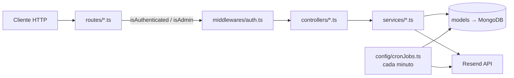

# 01 · Arquitectura

## Estructura del repositorio

```
Magicamente/
├── package.json            ← solo bcryptjs + jsonwebtoken (¡las usa el backend!)
├── package-lock.json
├── README.md
└── Backend/
    ├── package.json        ← dependencias y scripts del servidor
    ├── tsconfig.json
    └── src/
        ├── index.ts                 Punto de entrada: Express, rutas, conexión BD, cron
        ├── config/
        │   ├── db.ts                Conexión a MongoDB (carga dotenv)
        │   ├── cronJobs.ts          Recordatorios de citas (node-cron)
        │   ├── emailTemplates.ts    Plantillas HTML de correo
        │   └── emailConfig.ts       (vacío)
        ├── middlewares/
        │   ├── auth.ts              isAuthenticated (JWT) e isAdmin
        │   └── asyncHandler.ts      Envuelve handlers async (solo se usa en /auth)
        ├── models/                  Esquemas Mongoose
        │   ├── User.ts
        │   ├── Schedule.ts
        │   └── appointment.ts
        ├── routes/                  Definición de endpoints
        ├── controllers/             Leen req, llaman al servicio, responden
        └── services/                Lógica de negocio y acceso a datos
```

## Capas

El código sigue un patrón **rutas → controladores → servicios → modelos**:



| Capa | Responsabilidad | Ejemplo |
|---|---|---|
| **routes** | Asocia método + ruta + middlewares + controlador | `router.post('/', isAuthenticated, createSchedule)` |
| **middlewares** | Autenticación JWT y control de rol | `isAuthenticated`, `isAdmin` |
| **controllers** | Extraen datos de `req`, gestionan códigos HTTP | `scheduleController.createSchedule` |
| **services** | Reglas de negocio y consultas Mongoose | `appointmentService.scheduleAppointment` |
| **models** | Esquema e interfaz TypeScript de cada colección | `User`, `Schedule`, `Appointment` |

La separación no es del todo consistente: algunos servicios devuelven `{ error }` y otros lanzan excepciones, y algunas validaciones están en el controlador (p. ej. fecha pasada al crear horario). Ver [06 · Problemas conocidos](06-problemas-conocidos.md).

## Arranque del servidor (`src/index.ts`)

1. Se importan los módulos. **Orden importante:** `config/db.ts` ejecuta `dotenv.config()` al importarse, y se importa antes que las rutas. Por eso, cuando `services/emailService.ts` crea `new Resend(process.env.RESEND_API_KEY)` a nivel de módulo, la variable ya está cargada. Si se cambia el orden de los imports, Resend se quedaría sin clave.
2. Importar `config/cronJobs.ts` registra la tarea programada (no hay que llamar a nada).
3. Middlewares globales: `cors()` (abierto a cualquier origen) y `express.json()`.
4. `connectDB()` (si falla, `process.exit(1)`).
5. Montaje de rutas:

| Prefijo | Router |
|---|---|
| `/api/auth` | `routes/auth.ts` |
| `/api/users` | `routes/user.ts` |
| `/api/appointments` | `routes/appointment.ts` |
| `/api/schedule` | `routes/schedule.ts` |
| `/api/notifications` | `routes/notification.ts` |
| `/api/email` | `routes/emailRoutes.ts` |

6. `GET /` responde un texto de salud. Escucha en `PORT` (3000 por defecto).

## Autenticación

- `POST /api/auth/login` devuelve un JWT firmado con `JWT_SECRET` (respaldo `'secret'`), payload `{ id, role }`, caducidad **1 hora**. No hay refresh token.
- `isAuthenticated` espera `Authorization: Bearer <token>` y deja `req.user = { id, role }`.
- `isAdmin` exige `req.user.role === 'administrador'`. Solo se usa en `GET /api/users`.
- **No existe** un middleware de rol para psicólogo ni comprobaciones de propiedad (“¿este recurso es mío?”).

## Roles

Definidos en `models/User.ts`: `paciente` (por defecto), `psicologo`, `administrador`.

## Correo

Hay **dos** servicios de correo que hacen casi lo mismo:

- `services/emailService.ts` → `sendEmail(templateName, to, ...args)` usa las plantillas de `config/emailTemplates.ts`; remitente `Soporte <support@magicamente.online>`. Es el que usan el registro y el cron.
- `services/notificationService.ts` → `sendEmail({from,to,subject,html})` genérico; solo lo usa el endpoint de prueba `/api/notifications/test`.

## Scripts (`Backend/package.json`)

| Script | Qué hace | Estado |
|---|---|---|
| `npm run dev` | `ts-node-dev --respawn --transpile-only src/index.ts` | ✅ Funciona |
| `npm run build` | `tsc` | ⚠️ Compila sin errores, pero **no hay `outDir`**: deja los `.js` junto a los `.ts` en `src/` |
| `npm start` | `node dist/index.js` | ❌ Falla: `dist/` nunca se genera |
| `npm test` | — | No hay tests |
