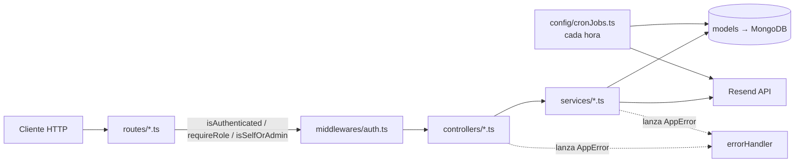

# 01 · Arquitectura

## Estructura del repositorio

```
Magicamente/
├── README.md
├── docs/                        Esta wiki
├── .github/workflows/backend.yml  CI: typecheck, build y tests en cada push
└── Backend/
    ├── package.json             Dependencias y scripts
    ├── tsconfig.json            Compilación de src/ → dist/
    ├── tsconfig.test.json       Typecheck de src/ + tests/
    ├── vitest.config.ts
    ├── .env.example
    ├── tests/                   Tests de integración (Vitest + Supertest + MongoDB en memoria)
    └── src/
        ├── index.ts                 Arranque: valida entorno, conecta BD, inicia cron, escucha
        ├── app.ts                   createApp(): Express con rutas y manejo de errores (sin BD)
        ├── config/
        │   ├── env.ts               Lectura y validación de variables de entorno
        │   ├── db.ts                connectDB(uri)
        │   ├── cronJobs.ts          Recordatorios de citas (sendAppointmentReminders, startCronJobs)
        │   ├── migrations.ts        Migración idempotente al arrancar (estados e índices de citas)
        │   └── emailTemplates.ts    Plantillas HTML de correo
        ├── middlewares/
        │   ├── auth.ts              isAuthenticated, requireRole, isAdmin, isSelfOrAdmin
        │   ├── asyncHandler.ts      Lleva los errores de handlers async al middleware de errores
        │   └── errorHandler.ts      404 de rutas y traducción de errores a JSON
        ├── models/                  Esquemas Mongoose (User, Schedule, appointment)
        ├── routes/                  Definición de endpoints
        ├── controllers/             Validan la entrada y responden
        ├── services/                Lógica de negocio y acceso a datos
        └── utils/AppError.ts        Error con código HTTP
```

## Capas



| Capa | Responsabilidad |
|---|---|
| **routes** | Asocia método + ruta + middlewares + controlador envuelto en `asyncHandler` |
| **middlewares** | Autenticación JWT, roles, propiedad del recurso, manejo de errores |
| **controllers** | Validan la entrada, toman el usuario de `req.user` y responden |
| **services** | Reglas de negocio y consultas; lanzan `AppError(status, mensaje)` |
| **models** | Esquema e interfaz TypeScript de cada colección |

### Manejo de errores

Los servicios y controladores lanzan `new AppError(404, 'Usuario no encontrado')`. `asyncHandler` lo pasa a `errorHandler`, que responde `{ "message": ... }` con ese código. Además traduce:

| Error | Respuesta |
|---|---|
| `AppError` | su código y mensaje |
| `CastError` de Mongoose (id mal formado) | 400 |
| `ValidationError` de Mongoose | 400 con la lista de campos |
| Clave duplicada (código 11000) | 409 |
| JSON mal formado | 400 |
| Cualquier otro | 500 `Error interno del servidor` (el detalle solo va al log) |

## Arranque (`src/index.ts`)

1. `import 'dotenv/config'` en la primera línea carga `Backend/.env`.
2. `assertRequiredEnv()`: si falta `JWT_SECRET`, el proceso termina con un mensaje claro.
3. `connectDB(getMongoUri())`.
4. `runMigrations()`: corrige citas `'cancelled'` → `'cancelada'` y sincroniza los índices de `Appointment`.
5. `startCronJobs()` programa los recordatorios.
6. `createApp().listen(PORT)`.

`app.ts` no conecta a la base de datos ni arranca el cron: así los tests pueden montar la app con Supertest.

| Prefijo | Router |
|---|---|
| `/api/auth` | `routes/auth.ts` |
| `/api/users` | `routes/user.ts` |
| `/api/appointments` | `routes/appointment.ts` |
| `/api/schedule` | `routes/schedule.ts` |
| `/api/psychologists` | `routes/psychologist.ts` |

## Autenticación y autorización

- `POST /api/auth/login` devuelve un JWT firmado con `JWT_SECRET` (obligatorio, sin valor por defecto), payload `{ id, role }`, caducidad 1 hora.
- `isAuthenticated` exige `Authorization: Bearer <token>` y deja `req.user = { id, role }` (tipado globalmente en `auth.ts`).
- `requireRole('psicologo', 'administrador')` deja pasar solo esos roles.
- `isAdmin` = `requireRole('administrador')`.
- `isSelfOrAdmin()` exige que `req.params.id` sea el propio usuario, o rol administrador.
- La propiedad de las citas se comprueba en `appointmentService.getOwnedAppointment` (paciente o psicólogo de la cita, o administrador).

Roles: `paciente` (por defecto), `psicologo`, `administrador`. El registro público solo admite los dos primeros.

## Correo

`services/emailService.ts` → `sendEmail(plantilla, destinatario, ...args)`, tipado según la plantilla. El cliente de Resend se crea la primera vez que hace falta. **Sin `RESEND_API_KEY` no se envía nada**: se escribe un aviso en consola, útil en desarrollo y en los tests.

## Scripts (`Backend/package.json`)

| Script | Qué hace |
|---|---|
| `npm run dev` | Desarrollo con recarga (`ts-node-dev`) |
| `npm run build` | Compila `src/` a `dist/` |
| `npm start` | Ejecuta `dist/index.js` |
| `npm test` | Tests de integración (Vitest) |
| `npm run typecheck` | Comprueba tipos de `src/` y `tests/` |

## Tests

- `tests/setup.ts` arranca una MongoDB en memoria (`mongodb-memory-server`), fija `JWT_SECRET` y vacía las colecciones tras cada test. La primera ejecución descarga el binario de MongoDB (~100 MB) desde fastdl.mongodb.org.
- `tests/helpers.ts`: `createUser(rol)` crea usuarios directamente en la BD (incluidos administradores) y devuelve su token.
- Ficheros: `auth`, `users`, `psychologists`, `schedule`, `appointments`, `migrations`, `reminders` (con `sendEmail` simulado) y `env`.
- CI: `.github/workflows/backend.yml` ejecuta typecheck, build y tests en cada push y pull request.
