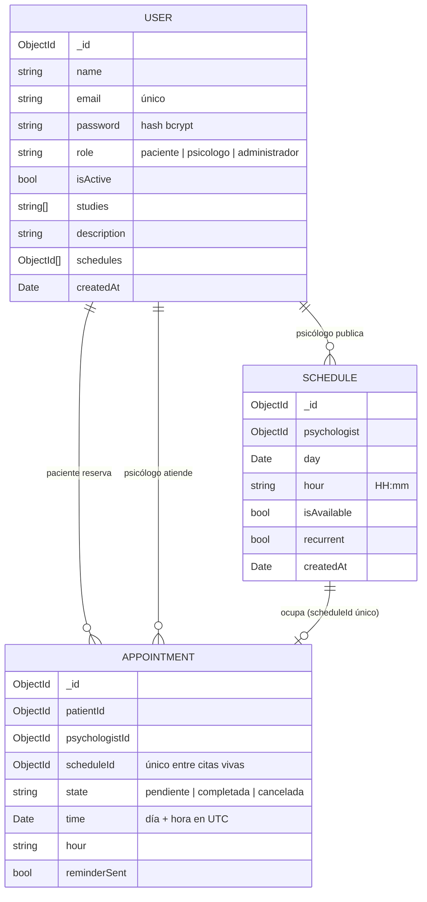

# 02 · Modelo de datos

MongoDB con tres colecciones (Mongoose pluraliza: `users`, `schedules`, `appointments`).

## `User` (`models/User.ts`)

| Campo | Tipo | Reglas | Notas |
|---|---|---|---|
| `name` | String | obligatorio | |
| `email` | String | obligatorio, **único** | Sin normalizar (mayúsculas/espacios cuentan como distintos) |
| `password` | String | obligatorio | Hash bcrypt (10 rondas), también al cambiarla por `PUT /api/users/:id` |
| `role` | enum | `paciente` (defecto), `psicologo`, `administrador` | En el registro solo `paciente` o `psicologo`; el resto lo cambia un administrador |
| `isActive` | Boolean | defecto `true` | `false` bloquea el login (403), invalida los tokens (401), oculta al psicólogo del listado y no recibe correos de recuperación |
| `studies` | [String] | defecto `[]` | Formación del psicólogo |
| `description` | String | | No se puede rellenar al registrarse, solo con `PUT` |
| `schedules` | [ObjectId → Schedule] | | Se añade cada horario creado; nunca se limpia |
| `passwordResetTokenHash` | String | oculto (`select: false`) | SHA-256 del token de recuperación; se borra al usarlo |
| `passwordResetExpires` | Date | oculto (`select: false`) | Caducidad del token (1 h); `expires - 1 h` indica cuándo se pidió |
| `deletedAt` | Date | | Fecha de eliminación de la cuenta (anonimizada); los listados y perfiles la ocultan |
| `passwordChangedAt` | Date | oculto (`select: false`) | Se actualiza al cambiar o restablecer la contraseña; los tokens anteriores dejan de valer |
| `createdAt` | Date | defecto ahora | |

## `Schedule` (`models/Schedule.ts`)

Una **franja horaria concreta** de un psicólogo (no un horario semanal).

| Campo | Tipo | Reglas | Notas |
|---|---|---|---|
| `psychologist` | ObjectId → User | obligatorio | Debe ser un usuario con rol `psicologo`; si lo crea un psicólogo, es siempre él mismo |
| `day` | Date | obligatorio | Fecha; se espera medianoche UTC, p. ej. `"2026-12-15"` |
| `hour` | String | obligatorio | Formato `"HH:mm"`, se interpreta **en UTC** al reservar |
| `isAvailable` | Boolean | defecto `true` | `false` cuando hay una cita reservada |
| `recurrent` | Boolean | defecto `false` | **Sin uso**: no existe lógica de recurrencia |
| `createdAt` | Date | defecto ahora | |

Unicidad (`psychologist` + `day` + `hour`) solo se comprueba en código, no con un índice.

## `Appointment` (`models/appointment.ts`)

| Campo | Tipo | Reglas | Notas |
|---|---|---|---|
| `patientId` | ObjectId → User | obligatorio | El usuario autenticado que reserva |
| `psychologistId` | ObjectId → User | obligatorio | El dueño del horario reservado |
| `scheduleId` | ObjectId → Schedule | obligatorio, **índice único parcial** | Una franja solo puede tener una cita `pendiente` o `completada`; las `cancelada` no cuentan, así que se puede volver a reservar |
| `state` | enum | `pendiente` (defecto), `completada`, `cancelada` | `pendiente → cancelada` (cancelar) o `pendiente → completada` (psicólogo, tras la cita). No hay más transiciones |
| `time` | Date | obligatorio | `schedule.day` con `setUTCHours(hora, minutos)` |
| `hour` | String | obligatorio | Copia de `schedule.hour` |
| `reminderSent` | Boolean | defecto `false` | `true` cuando ya se envió el recordatorio (las citas antiguas sin el campo cuentan como no enviadas) |

Los índices de `Appointment` los sincroniza `config/migrations.ts` al arrancar (`autoIndex` desactivado en ese esquema). No hay `timestamps` en ningún modelo, ni borrado en cascada (borrar un usuario deja horarios y citas huérfanos).

## Zonas horarias

Todo se guarda en UTC y `hour` se aplica como hora UTC. Si los usuarios están en, por ejemplo, UTC‑5, un horario `"10:00"` corresponde a las 05:00 locales. Hay que decidir una convención (guardar la zona del psicólogo, o que el frontend envíe instantes ISO completos).
