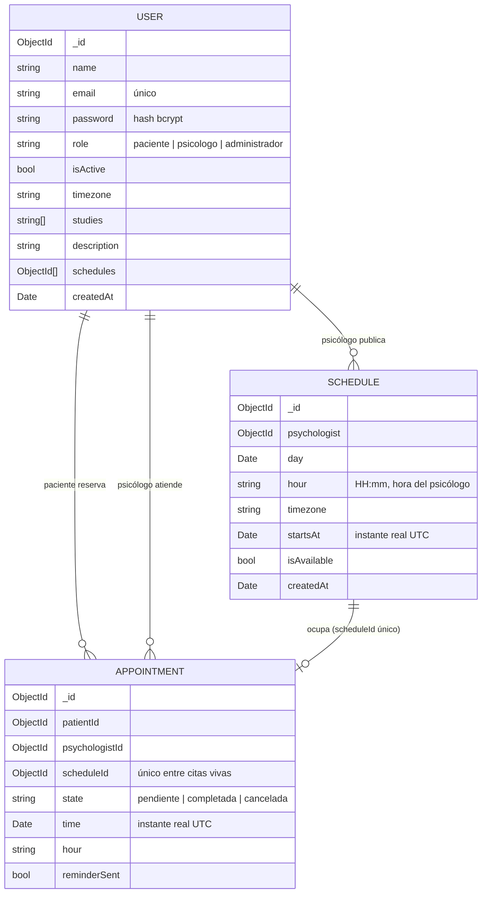

# 02 · Modelo de datos

MongoDB con tres colecciones (Mongoose pluraliza: `users`, `schedules`, `appointments`).

## `User` (`models/User.ts`)

| Campo | Tipo | Reglas | Notas |
|---|---|---|---|
| `name` | String | obligatorio | |
| `email` | String | obligatorio, **único** | Sin normalizar (mayúsculas/espacios cuentan como distintos) |
| `password` | String | obligatorio | Hash bcrypt (10 rondas), también al cambiarla por `PUT /api/users/:id` |
| `role` | enum | `paciente` (defecto), `psicologo`, `administrador` | En el registro solo `paciente` o `psicologo`; el resto lo cambia un administrador |
| `isActive` | Boolean | defecto `true` | `false` bloquea el login (403), invalida los tokens (401), oculta al psicólogo del listado y no recibe correos de recuperación |
| `studies` | [String] | defecto `[]` | Formación del psicólogo |
| `description` | String | | No se puede rellenar al registrarse, solo con `PUT` |
| `schedules` | [ObjectId → Schedule] | | Se añade cada horario creado; nunca se limpia |
| `passwordResetTokenHash` | String | oculto (`select: false`) | SHA-256 del token de recuperación; se borra al usarlo |
| `passwordResetExpires` | Date | oculto (`select: false`) | Caducidad del token (1 h); `expires - 1 h` indica cuándo se pidió |
| `timezone` | String | defecto `UTC` (o `APP_TIMEZONE`), zona IANA válida | Zona horaria del usuario: define cómo se interpretan las franjas que crea (psicólogo) y la hora que ve en los correos |
| `deletedAt` | Date | | Fecha de eliminación de la cuenta (anonimizada); los listados y perfiles la ocultan |
| `passwordChangedAt` | Date | oculto (`select: false`) | Se actualiza al cambiar o restablecer la contraseña; los tokens anteriores dejan de valer |
| `createdAt` | Date | defecto ahora | |

## `Schedule` (`models/Schedule.ts`)

Una **franja horaria concreta** de un psicólogo (no un horario semanal; las series se crean con `repeatWeeks`, una franja independiente por semana).

| Campo | Tipo | Reglas | Notas |
|---|---|---|---|
| `psychologist` | ObjectId → User | obligatorio | Debe ser un psicólogo activo; si lo crea un psicólogo, es siempre él mismo |
| `day` | Date | obligatorio | Día del **calendario del psicólogo**, a medianoche UTC (`2026-12-15T00:00:00.000Z` = “15 de diciembre”) |
| `hour` | String | obligatorio | Hora de pared del psicólogo, `"HH:mm"` |
| `timezone` | String | defecto `UTC` | Zona del psicólogo al crear la franja; `day` y `hour` están expresados en ella |
| `startsAt` | Date | obligatorio | **Instante real (UTC)** en que empieza: `day` + `hour` en `timezone`, con horario de verano. Un `pre('validate')` lo calcula si falta, así siempre es coherente |
| `isAvailable` | Boolean | defecto `true` | `false` cuando hay una cita reservada |
| `createdAt` | Date | defecto ahora | |

Unicidad (`psychologist` + `day` + `hour`) solo se comprueba en código, no con un índice. Se ordena y se filtra por `startsAt`.

## `Appointment` (`models/appointment.ts`)

| Campo | Tipo | Reglas | Notas |
|---|---|---|---|
| `patientId` | ObjectId → User | obligatorio | El usuario autenticado que reserva |
| `psychologistId` | ObjectId → User | obligatorio | El dueño del horario reservado |
| `scheduleId` | ObjectId → Schedule | obligatorio, **índice único parcial** | Una franja solo puede tener una cita `pendiente` o `completada`; las `cancelada` no cuentan, así que se puede volver a reservar |
| `state` | enum | `pendiente` (defecto), `completada`, `cancelada` | `pendiente → cancelada` (cancelar) o `pendiente → completada` (psicólogo, tras la cita). No hay más transiciones |
| `time` | Date | obligatorio | `schedule.startsAt`: el instante real de la cita |
| `hour` | String | obligatorio | Copia de `schedule.hour` |
| `reminderSent` | Boolean | defecto `false` | `true` cuando ya se envió el recordatorio (las citas antiguas sin el campo cuentan como no enviadas) |

Los índices de `Appointment` los sincroniza `config/migrations.ts` al arrancar (`autoIndex` desactivado en ese esquema). No hay `timestamps` en ningún modelo, ni borrado en cascada (borrar un usuario deja horarios y citas huérfanos).

## Zonas horarias

- **Se guardan instantes UTC** (`Schedule.startsAt`, `Appointment.time`). `day` y `hour` de una franja son la representación local del psicólogo, útil solo para mostrarla “como él la ve”.
- Cada usuario tiene `timezone`. Un psicólogo escribe `day`/`hour` en su zona y el servidor los convierte (`utils/timezone.ts`, sin librerías: `Intl.DateTimeFormat` + corrección en los cambios de hora). Una hora inexistente (el reloj salta hacia delante) se rechaza; una repetida (el reloj retrocede) usa la primera.
- Cambiar la `timezone` de un psicólogo **no mueve** las franjas ya creadas (su `startsAt` sigue siendo el mismo instante real). Al editarlas, se interpretan en la zona nueva.
- Los correos usan la zona del destinatario. `APP_TIMEZONE` es solo la zona por defecto de las cuentas nuevas.
- **Migración al arrancar** (`config/migrations.ts`): usuarios sin zona → `APP_TIMEZONE`; franjas antiguas → `startsAt` = día + hora en UTC (así se interpretaban hasta ahora) y `timezone: 'UTC'`.
