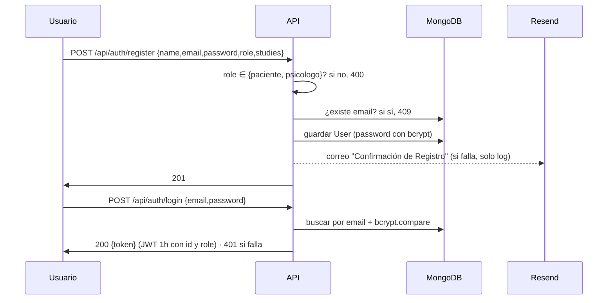
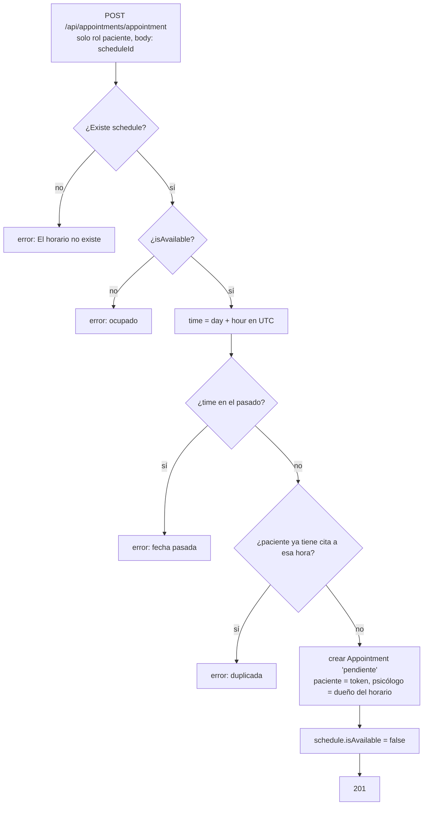

# 04 · Flujos de negocio

## 1. Registro y login

No hay verificación de email, recuperación de contraseña (existe la plantilla `resetPassword` pero ningún endpoint) ni cierre de sesión.

## 2. Publicar disponibilidad (psicólogo)

1. El psicólogo hace login.
2. Por cada franja: `POST /api/schedule { day, hour }`. El psicólogo es siempre el usuario autenticado (un administrador puede indicar `psychologist`).
3. Se valida la fecha (futura), el formato `HH:mm`, que el destinatario sea psicólogo y que no haya otra franja igual (409). Se crea el `Schedule` y se añade a `user.schedules`.

Cada franja es un hueco único (una fecha y una hora). El campo `recurrent` existe pero no genera franjas repetidas.

## 3. Reservar una cita (paciente)

Todos los `error` salen con código **201** (ver problemas). La comprobación de disponibilidad y la creación no son atómicas: dos reservas simultáneas pueden pasar la validación, aunque el índice único de `scheduleId` hará fallar a la segunda con un 500.

**¿Cómo encuentra el paciente a un psicólogo?** Si conoce su id, puede ver su perfil público con `GET /api/users/:id`. Pero todavía no hay un listado de psicólogos (`GET /api/users` es solo para administradores). Hay que añadirlo (ver hoja de ruta).

## 4. Modificar o cancelar

- **Cancelar**: estado → `'cancelled'` y la franja vuelve a estar disponible. Pero esa franja ya no se puede volver a reservar por el índice único de `scheduleId`.
- **Modificar**: solo el campo `state` (`pendiente`, `completada`, `cancelada`) y solo si faltan más de 24 h. Pasar a `cancelada` por aquí no libera la franja: para cancelar usa el endpoint de cancelación.
- Ambas solo las puede hacer el paciente o el psicólogo de la cita, o un administrador (si no, 403).

## 5. Recordatorios automáticos (`config/cronJobs.ts`)

- Expresión `"0 * * * *"` → al minuto 0 de **cada hora**.
- `sendAppointmentReminders()` busca citas en estado `pendiente`, con `reminderSent` distinto de `true` y que empiecen en las **próximas 24 horas**.
- Para cada una, primero marca `reminderSent: true` de forma atómica (así dos procesos no envían el mismo aviso) y luego envía `appointmentReminder` al paciente.
- Si el envío falla, vuelve a poner `reminderSent: false` para reintentarlo en la siguiente hora.
- Resultado: **un solo correo por cita**, entre 23 y 24 horas antes (o en la siguiente ejecución horaria, si se reserva con menos de 24 h de antelación).
- El correo muestra la fecha completa y la hora con minutos (“martes, 15 de diciembre de 2026 a las 10:00”) en la zona `APP_TIMEZONE` (por defecto `UTC`, la misma en la que se guardan las horas).

## 6. Plantillas de correo (`config/emailTemplates.ts`)

| Nombre | Parámetros | Uso |
|---|---|---|
| `confirmation` | `name` | Registro |
| `resetPassword` | `name`, `resetLink` | Sin uso |
| `appointmentReminder` | `name`, `date`, `hour` | Cron |

Remitente: `EMAIL_FROM` (por defecto `Soporte <support@magicamente.online>`). Sin `RESEND_API_KEY` los correos no se envían: se muestra un aviso en consola. El dominio tiene que estar verificado en la cuenta de Resend asociada a `RESEND_API_KEY`.
