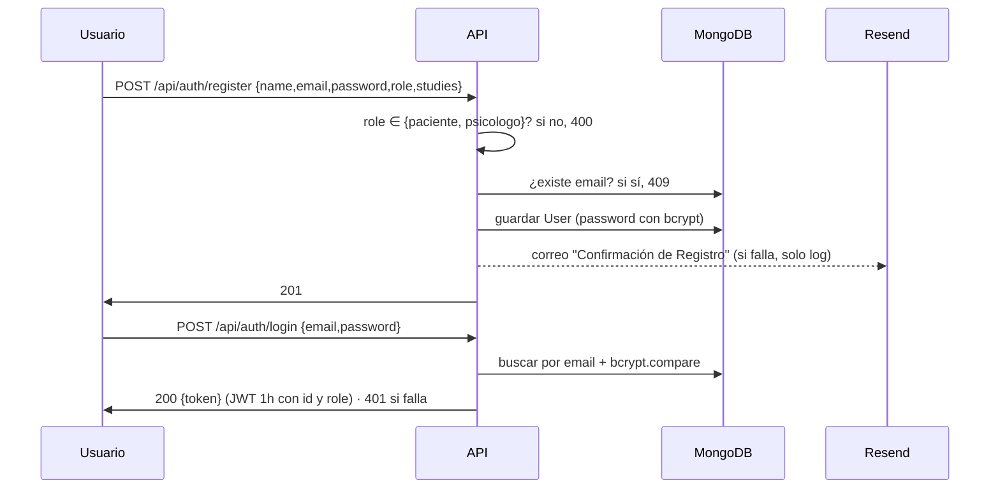
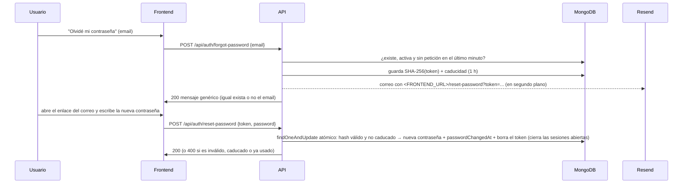
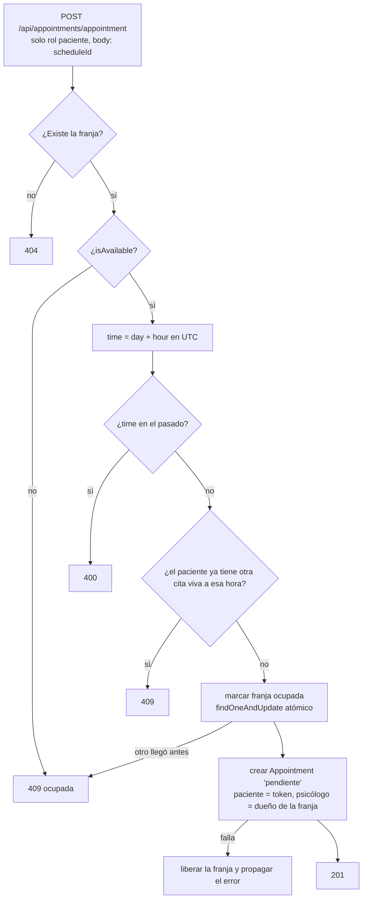
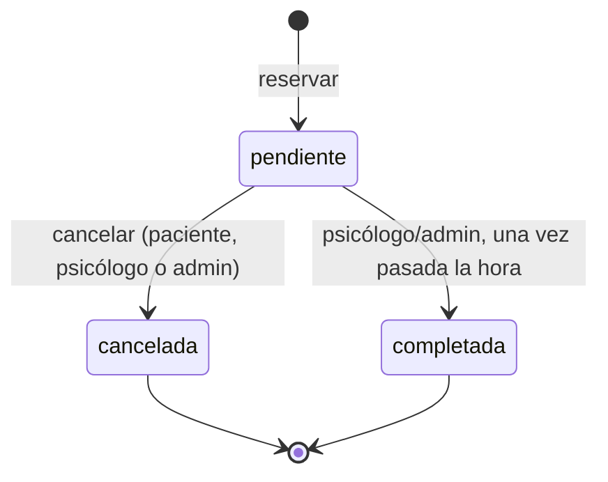

# 04 · Flujos de negocio

## 1. Registro y login

No hay verificación de email ni botón de “cerrar sesión” en el servidor: el cliente borra su token. Aun así, un token deja de valer al instante si se borra o desactiva al usuario, o si cambia su contraseña (ver [arquitectura](01-arquitectura.md#autenticación-y-autorización)).

### Recuperación de contraseña

Decisiones de seguridad:
- El token son 32 bytes aleatorios (`crypto.randomBytes`); la base de datos solo guarda su hash, así que una filtración de la BD no permite restablecer cuentas.
- La respuesta es idéntica exista o no el email, y el correo se envía en segundo plano para que el tiempo de respuesta tampoco lo delate.
- Un solo uso garantizado por una operación atómica; dos peticiones simultáneas con el mismo token no pueden ganar las dos.
- Dos límites contra el abuso: un correo por minuto y cuenta, y 10 peticiones por hora y IP.
- El nombre del usuario se escapa en el HTML del correo.

**El frontend** debe tener una pantalla `/reset-password` que lea `token` de la URL y llame a `reset-password`. Configura su dirección en `FRONTEND_URL`.

## 2. Publicar disponibilidad (psicólogo)

1. El psicólogo hace login.
2. Por cada franja: `POST /api/schedule { day, hour }`. El psicólogo es siempre el usuario autenticado (un administrador puede indicar `psychologist`).
3. Se valida la fecha (futura), el formato `HH:mm`, que el destinatario sea psicólogo y que no haya otra franja igual (409). Se crea el `Schedule` y se añade a `user.schedules`.

Cada franja es un hueco único (una fecha y una hora). El campo `recurrent` existe pero no genera franjas repetidas.

**Gestionar franjas ya publicadas:** el psicólogo puede cambiar el día o la hora (`PUT /api/schedule/:id`) o borrarla (`DELETE`), **solo si está libre**. Si un paciente la reservó, el psicólogo debe cancelar antes la cita. Ambas operaciones están condicionadas a `isAvailable: true` en la propia escritura, así que una reserva simultánea nunca queda con la franja modificada o borrada.

## 3. Reservar una cita (paciente)

La reserva es atómica: la franja se marca ocupada con una sola operación condicionada a `isAvailable: true`, así que si dos pacientes llegan a la vez solo uno recibe 201 y el otro 409. Si crear la cita falla después, la franja se libera.

**¿Cómo encuentra el paciente a un psicólogo?**
1. `GET /api/psychologists?q=ana` → lista de psicólogos activos (nombre, estudios y descripción).
2. `GET /api/schedule/:id?available=true` con el `_id` elegido → solo sus franjas libres y futuras, ordenadas (también acepta `from` y `to`).
3. `POST /api/appointments/appointment` con el `scheduleId`.

## 4. Ver, cancelar y completar

- **Mis citas** (`GET /appointment`): el paciente ve las suyas con los datos públicos del psicólogo; el psicólogo ve las suyas con nombre y email del paciente.
- **Cancelar**: solo citas `pendiente`. Pasa a `cancelada` y la franja vuelve a quedar disponible (se puede reservar otra vez). Cancelar una cita que ya no está `pendiente` devuelve 400; esto evita que una segunda cancelación libere una franja que otro paciente ya reservó.
- **Completar** (`PATCH /appointment/update/:id` con `{ "state": "completada" }`): solo el psicólogo de la cita (o un administrador), solo si está `pendiente` y su hora ya pasó.
- Cancelar, completar y consultar solo las puede hacer el paciente o el psicólogo de la cita, o un administrador (si no, 403).

## 5. Recordatorios automáticos (`config/cronJobs.ts`)

- Expresión `"0 * * * *"` → al minuto 0 de **cada hora**.
- `sendAppointmentReminders()` busca citas en estado `pendiente`, con `reminderSent` distinto de `true` y que empiecen en las **próximas 24 horas**.
- Para cada una, primero marca `reminderSent: true` de forma atómica (así dos procesos no envían el mismo aviso) y luego envía `appointmentReminder` al paciente.
- Si el envío falla, vuelve a poner `reminderSent: false` para reintentarlo en la siguiente hora.
- Resultado: **un solo correo por cita**, entre 23 y 24 horas antes (o en la siguiente ejecución horaria, si se reserva con menos de 24 h de antelación).
- El correo muestra la fecha completa y la hora con minutos (“martes, 15 de diciembre de 2026 a las 10:00”) en la zona `APP_TIMEZONE` (por defecto `UTC`, la misma en la que se guardan las horas).

## 6. Plantillas de correo (`config/emailTemplates.ts`)

| Nombre | Parámetros | Uso |
|---|---|---|
| `confirmation` | `name` | Registro |
| `resetPassword` | `name`, `resetLink` | Recuperación de contraseña |
| `appointmentReminder` | `name`, `date`, `hour` | Cron |

Remitente: `EMAIL_FROM` (por defecto `Soporte <support@magicamente.online>`). Sin `RESEND_API_KEY` los correos no se envían: se muestra un aviso en consola. El dominio tiene que estar verificado en la cuenta de Resend asociada a `RESEND_API_KEY`.
