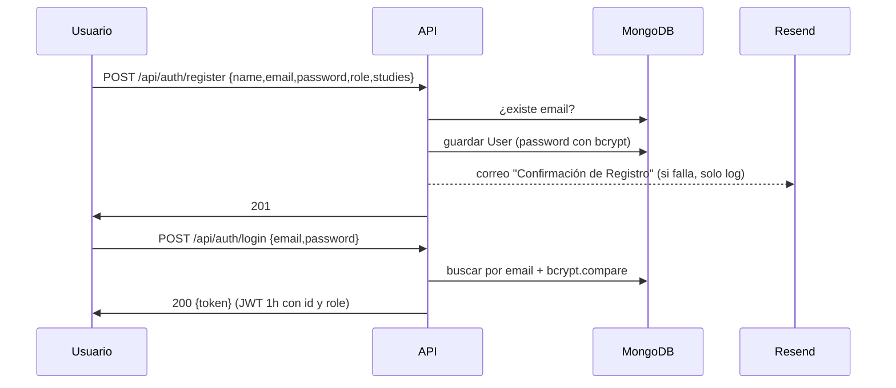
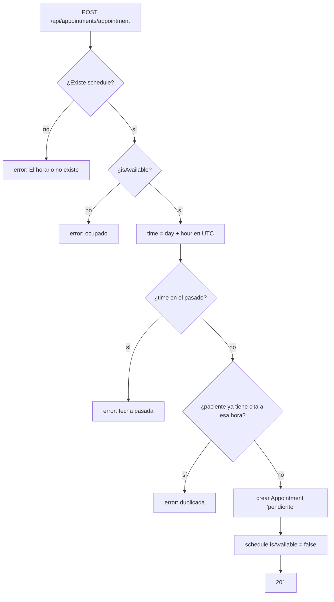

# 04 · Flujos de negocio

## 1. Registro y login

No hay verificación de email, recuperación de contraseña (existe la plantilla `resetPassword` pero ningún endpoint) ni cierre de sesión.

## 2. Publicar disponibilidad (psicólogo)

1. El psicólogo hace login y obtiene su `id` del JWT.
2. Por cada franja: `POST /api/schedule { psychologist, day, hour }`.
3. El servicio valida que el psicólogo existe y que no hay otra franja igual, crea el `Schedule` y lo añade a `user.schedules`.

Cada franja es un hueco único (una fecha y una hora). El campo `recurrent` existe pero no genera franjas repetidas.

## 3. Reservar una cita (paciente)

Todos los `error` salen con código **201** (ver problemas). La comprobación de disponibilidad y la creación no son atómicas: dos reservas simultáneas pueden pasar la validación, aunque el índice único de `scheduleId` hará fallar a la segunda con un 500.

**¿Cómo encuentra el paciente a un psicólogo?** Hoy no hay forma: `GET /api/users` es solo para administradores y no existe un endpoint público de psicólogos. Hay que añadirlo (ver hoja de ruta).

## 4. Modificar o cancelar

- **Cancelar**: estado → `'cancelled'` y la franja vuelve a estar disponible. Pero esa franja ya no se puede volver a reservar por el índice único de `scheduleId`.
- **Modificar**: solo si faltan más de 24 h. Sobrescribe los campos recibidos; no reasigna franjas.
- Ninguna de las dos comprueba que quien llama sea el paciente o el psicólogo de la cita.

## 5. Recordatorios automáticos (`config/cronJobs.ts`)

- Expresión `"* * * * *"` → **se ejecuta cada minuto**.
- Busca citas cuyo `time` cae en “mañana” (calculado con la hora local del servidor) y envía `appointmentReminder` a cada paciente.
- Consecuencias:
  - Cada paciente recibe el recordatorio **una vez por minuto durante todo el día anterior** (~1440 correos). No hay marca de “recordatorio enviado”.
  - Incluye citas canceladas.
  - El correo dice “cita el *15* a las *10*”: solo el día del mes y la hora UTC, sin mes ni minutos.

Probablemente la intención era una ejecución diaria (p. ej. `"0 9 * * *"`) o un envío ~24 h antes con un campo `reminderSent`.

## 6. Plantillas de correo (`config/emailTemplates.ts`)

| Nombre | Parámetros | Uso |
|---|---|---|
| `confirmation` | `name` | Registro, `/api/email/send-test` |
| `resetPassword` | `name`, `resetLink` | Sin uso |
| `appointmentReminder` | `name`, `date`, `hour` | Cron |

Remitente: `Soporte <support@magicamente.online>`. El dominio tiene que estar verificado en la cuenta de Resend asociada a `RESEND_API_KEY`.
